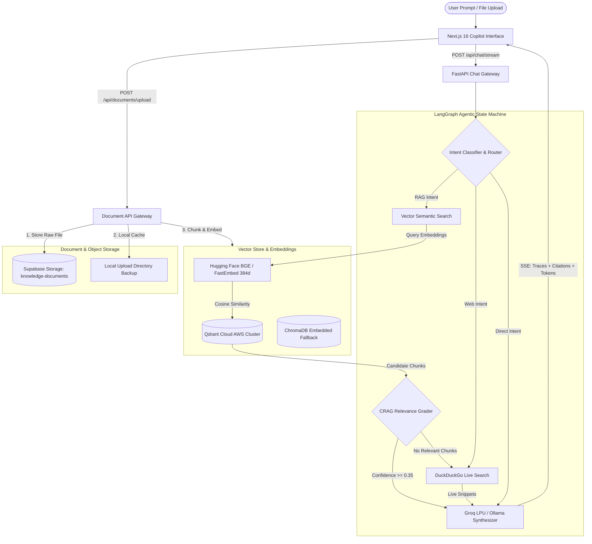

# 🚀 Enterprise Agentic RAG Copilot

[](https://github.com/langchain-ai/langgraph)
[](https://fastapi.tiangolo.com)
[](https://nextjs.org)
[](https://supabase.com)
[](https://qdrant.tech)
[](https://www.trychroma.com)
[-F55036.svg)](https://groq.com)
[-purple.svg)](https://ollama.ai)
[](https://www.docker.com)
[](LICENSE)

An enterprise-grade, hybrid cloud & self-hosted **Agentic Retrieval-Augmented Generation (RAG) Copilot** built with **LangGraph**, **FastAPI**, **Supabase Cloud Storage**, **Qdrant Cloud / ChromaDB**, and **Next.js 16**. Powered by **Groq LPU (`qwen/qwen3.8-27b`)** for ultra-low latency token generation (with local **Ollama** fallback) and **Hugging Face (`BAAI/bge-small-en-v1.5`)** embeddings via FastEmbed ONNX runtime for ultra-fast, lightweight 384-dimensional semantic retrieval (with local **Ollama** fallback).

---

## 🌟 Key Features

- **⚡ Corrective RAG (CRAG) Workflow:** Built with a **LangGraph state machine** that autonomously routes queries, evaluates retrieved chunks for semantic relevance, filters noise, and triggers real-time web fallbacks if internal documentation is insufficient.
- **☁️ Supabase Cloud Storage:** Raw enterprise documents (PDF with page splitting, Markdown, TXT, CSV) are stored securely in **Supabase Storage** in the `knowledge-documents` bucket with public access URLs and synchronized two-way deletion.
- **🎯 Multi-Provider Vector Store:** Dual-engine vector indexing supporting production **Qdrant Cloud (AWS cluster)** with automatic local **ChromaDB** fallback.
- **⚡ Ultra-Fast Inference via Groq LPU & Local Ollama:** Sub-second time-to-first-token (TTFT) powered by Groq's high-speed inference engine (`qwen/qwen3.8-27b`), with optional 100% offline local inference using Ollama (`qwen3:1.7b`).
- **📡 Real-Time SSE Token & Trace Streaming:** Server-Sent Events (SSE) that stream LLM tokens, source citations, and LangGraph agent execution traces (`Routing` → `Retrieval` → `CRAG Grading` → `Synthesis`) directly to the frontend.
- **📚 Interactive Knowledge Base Manager:** Drag-and-drop file ingestion, individual document deletion with live progress spinners, text snippet note indexer, and sample enterprise policy seeding.
- **🏷️ Verifiable Citations & Source Drawer:** Every response features interactive citation badges (`[Doc 1]`, `[Web 1]`) displaying cosine match scores, page numbers, and exact chunk previews in a slide-out drawer with direct links to Supabase Storage.
- **🌐 Live Web Intelligence Fallback:** Integrates DuckDuckGo live search for real-time external queries or when internal documentation lacks coverage.
- **🐳 Enterprise Docker Orchestration:** Complete multi-container setup via `docker-compose.yml` linking FastAPI, Supabase storage configs, and Next.js.

---

## 🏛️ System Architecture



---

## 💼 Resume Highlights (For Software & AI Engineers)

> *Add these bullet points directly to your resume under Projects or Experience:*

- **Enterprise Agentic RAG Copilot (FastAPI, LangGraph, Supabase Storage, Qdrant Cloud, Next.js, Groq):**
  - Architected a hybrid enterprise Agentic RAG system with **LangGraph**, implementing **Corrective RAG (CRAG)** to autonomously grade vector document relevance and trigger dynamic web fallbacks.
  - Implemented cloud object storage with **Supabase Storage** (`knowledge-documents` bucket) for enterprise document archiving and synchronized multi-chunk deletions.
  - Deployed dual-tier vector storage with **Qdrant Cloud** and **ChromaDB**, using **Hugging Face (`BAAI/bge-small-en-v1.5`)** via FastEmbed for high-accuracy 384-dimensional normalized cosine retrieval.
  - Built an asynchronous **FastAPI** backend supporting **Server-Sent Events (SSE)** for real-time streaming of LLM tokens, step-by-step reasoning traces, and citation metadata via **Groq LPU** (`qwen/qwen3.8-27b`).
  - Developed a high-performance **Next.js 16** dashboard featuring interactive citation inspection drawers, live LangGraph trace timelines, and drag-and-drop document ingestion.
  - Containerized services with **Docker Compose**, establishing environment-driven configurations and volume persistence.

---

## 📂 Project Structure

```
.
├── .env                       # Local secrets & credentials (git-ignored)
├── .env.example               # Template environment configuration
├── .gitignore                 # Comprehensive git-ignore rules
├── LICENSE                    # Apache License 2.0
├── README.md                  # System documentation & architectural guide
├── docker-compose.yml         # Container orchestration
├── backend/
│   ├── Dockerfile             # FastAPI backend container definition
│   ├── requirements.txt       # Python dependencies (FastAPI, LangGraph, Supabase, Qdrant)
│   ├── run.py                 # Uvicorn server launcher
│   └── app/
│       ├── config.py          # Pydantic Settings & environment discovery
│       ├── main.py            # FastAPI app lifecycle, CORS, startup handlers
│       ├── agent/
│       │   ├── state.py       # LangGraph AgentState and Citation schemas
│       │   ├── graph.py       # CRAG StateGraph (Router -> Retrieve -> Grade -> Web -> Generate)
│       │   ├── tools.py       # Vector store retriever & DuckDuckGo search tools
│       │   └── prompts.py     # System prompts tuned for Qwen models
│       ├── core/
│       │   ├── supabase_client.py # Supabase Storage manager (knowledge-documents bucket)
│       │   ├── vector_store.py    # Qdrant Cloud & ChromaDB manager
│       │   ├── llm_client.py      # Groq cloud LPU inference client
│       │   ├── embedding_provider.py # Hugging Face FastEmbed & Ollama embedding manager
│       │   └── ollama_client.py   # Ollama local inference client
│       ├── services/
│       │   ├── document_service.py# Supabase ingestion, PDF parsing, chunking, deletions
│       │   └── chat_service.py    # Session manager & SSE token streaming generator
│       └── api/
│           ├── routes_chat.py     # POST /api/chat/stream, session CRUD
│           ├── routes_documents.py# Document upload, raw text indexing, delete endpoints
│           └── routes_health.py   # GET /api/health (LLM, Qdrant, Supabase status)
└── frontend/
    ├── Dockerfile             # Multi-stage Next.js production Dockerfile
    ├── package.json           # Frontend dependencies
    └── src/
        ├── app/
        │   ├── globals.css    # Enterprise glassmorphism, dark theme, markdown styles
        │   ├── layout.tsx     # Root layout with metadata
        │   └── page.tsx       # Copilot workspace, message feed, starter prompts
        ├── components/
        │   ├── Header.tsx     # Live health indicator, mode selector, vector stats
        │   ├── Sidebar.tsx    # Conversation history, knowledge base modal toggle
        │   ├── ChatInput.tsx  # Multi-line input, document shortcut, stop button
        │   ├── MessageItem.tsx# Markdown renderer, code blocks, citation badges
        │   ├── AgentTraceTimeline.tsx # Visual LangGraph execution timeline
        │   ├── CitationsDrawer.tsx    # Source chunk inspector with similarity scores
        │   └── KnowledgeBaseModal.tsx # Supabase document uploader, inventory, deletions
        └── lib/
            ├── api.ts         # SSE stream consumer & REST API client
            └── types.ts       # Shared TypeScript interfaces
```

---

## ⚡ Quick Start (Local Development)

### Prerequisites

1. **Python 3.10+**
2. **Node.js 18+**
3. **Hugging Face & Ollama:**
   - **Hugging Face Embeddings (Default):** Runs automatically with `HUGGINGFACE_API_KEY` using FastEmbed ONNX (zero GPU/PyTorch overhead, 100% free).
   - **Ollama (Optional Local Fallback):** Installed locally if running in 100% self-hosted offline mode:
     ```bash
     ollama pull qwen3:1.7b
     ollama pull nomic-embed-text
     ```

---

### 1. Environment Configuration

Copy `.env.example` to `.env` in the project root:

```bash
cp .env.example .env
```

Configure your credentials in `.env`:
```ini
# Groq Cloud (Recommended Ultra-Fast Cloud LPU - Free at https://console.groq.com)
LLM_PROVIDER="groq"
GROQ_API_KEY="gsk_your_groq_api_key_here"
GROQ_MODEL="qwen/qwen3.8-27b"

# Hugging Face Embeddings (Free Token at https://huggingface.co/settings/tokens)
EMBEDDING_PROVIDER="huggingface"
HUGGINGFACE_API_KEY="hf_your_huggingface_token_here"
EMBEDDING_MODEL="BAAI/bge-small-en-v1.5"

# Supabase Storage (Cloud Object Storage - Free at https://supabase.com)
SUPABASE_URL="https://your-project.supabase.co"
SUPABASE_PUBLISHABLE_KEY="your-supabase-publishable-key"
SUPABASE_SECRET_KEY="your-supabase-secret-key"
SUPABASE_BUCKET_NAME="knowledge-documents"

# Qdrant Cloud (Cloud Vector DB - Free 1GB at https://cloud.qdrant.io)
VECTOR_DB_TYPE="qdrant"
QDRANT_URL="https://your-cluster.qdrant.io"
QDRANT_API_KEY="your-qdrant-api-key"
```

---

### 2. Launch Backend (FastAPI)

```bash
cd backend
python3 -m venv venv
source venv/bin/activate
pip install -r requirements.txt
python run.py
```
> The API will be live at `http://localhost:8000`.  
> Interactive OpenAPI documentation: `http://localhost:8000/docs`.

---

### 3. Launch Frontend (Next.js)

```bash
cd frontend
npm install
npm run dev
```
> The Copilot UI will be live at `http://localhost:3000`.

---

## 🐳 Docker Deployment

To spin up the entire application inside Docker containers:

```bash
docker compose up --build
```

- **Frontend:** `http://localhost:3000`
- **Backend API:** `http://localhost:8000`

---

## 📡 API Reference

| Method | Endpoint | Description |
|---|---|---|
| `GET` | `/api/health` | Comprehensive health check (LLM, Qdrant/Chroma, Ollama status) |
| `POST` | `/api/chat/stream` | Server-Sent Events (SSE) streaming endpoint (Traces, Citations, Tokens) |
| `GET` | `/api/chat/sessions` | List all conversation sessions |
| `GET` | `/api/chat/sessions/{id}` | Retrieve chat history for a session |
| `DELETE`| `/api/chat/sessions/{id}` | Delete a chat session |
| `GET` | `/api/documents` | List indexed documents, chunk statistics, and Supabase storage URLs |
| `POST` | `/api/documents/upload` | Upload file to Supabase Storage (`knowledge-documents`) & index into vector DB |
| `POST` | `/api/documents/text` | Ingest raw text note or corporate SOP |
| `POST` | `/api/documents/seed` | Seed default enterprise policies (AI Governance, SRE, HR) |
| `DELETE`| `/api/documents/{file}` | Delete document from Supabase Storage and remove all vector embeddings |

---

## 📄 License

This project is licensed under the Apache License 2.0 - see the [LICENSE](LICENSE) file for details.
