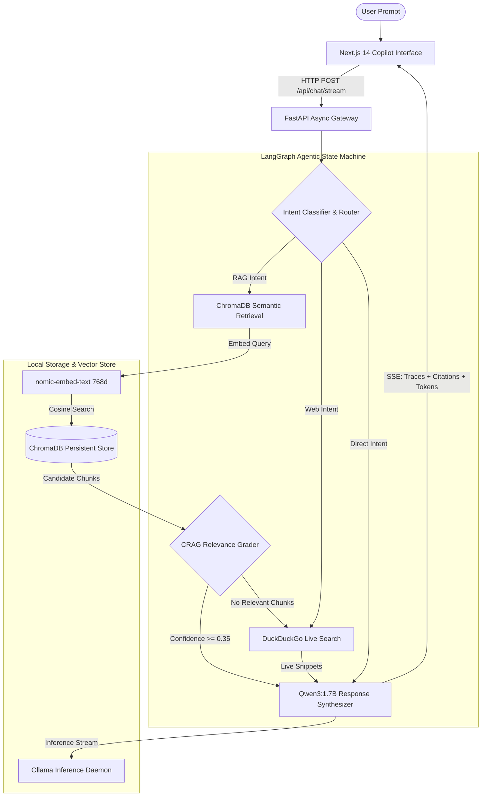

# 🚀 Enterprise Agentic RAG Copilot

[](https://github.com/langchain-ai/langgraph)
[](https://fastapi.tiangolo.com)
[](https://nextjs.org)
[](https://www.trychroma.com)
[-purple.svg)](https://ollama.ai)
[](https://www.docker.com)
[](LICENSE)

An enterprise-grade, self-hosted **Agentic Retrieval-Augmented Generation (RAG) Copilot** built with **LangGraph**, **FastAPI**, **ChromaDB**, and **Next.js 14**. Powered 100% locally by **Ollama (`qwen3:1.7b`)** for reasoning and **`nomic-embed-text`** for high-dimensional semantic embeddings—guaranteeing **zero API costs**, **complete data privacy**, and **air-gapped deployment readiness**.

---

## 🌟 Key Features

- **⚡ Corrective RAG (CRAG) Workflow:** Built with a **LangGraph state machine** that autonomously routes queries, evaluates retrieved chunks for semantic relevance, filters out noise, and triggers a real-time web fallback if internal documents are insufficient.
- **🔒 100% Free & Local Privacy:** Runs locally on **Ollama** using `qwen3:1.7b` and `nomic-embed-text` (768-dim embeddings). Zero subscriptions, zero external API keys, zero token fees.
- **📡 Real-Time SSE Token & Trace Streaming:** Implements Server-Sent Events (SSE) that stream LLM tokens, source citations, and LangGraph agent execution traces (`Routing` → `Retrieval` → `CRAG Grading` → `Synthesis`) directly to the frontend.
- **📚 Interactive Knowledge Base Manager:** Supports drag-and-drop ingestion of enterprise documentation (PDF with page splitting, Markdown, TXT, CSV), recursive semantic chunking, and metadata tracking.
- **🏷️ Verifiable Citations & Source Drawer:** Every response features interactive citation badges (`[Doc 1]`, `[Web 1]`) displaying cosine match scores, page numbers, and exact chunk previews in a slide-out drawer.
- **🌐 Live Web Intelligence Fallback:** Integrates DuckDuckGo live search for real-time external queries or when internal documentation lacks coverage.
- **🐳 Enterprise Docker Orchestration:** Complete multi-container setup via `docker-compose.yml` linking FastAPI, ChromaDB persistence, and Next.js.

---

## 🏛️ System Architecture



---

## 💼 Resume Highlights (For Software & AI Engineers)

> *Add these bullet points directly to your resume under Projects or Experience:*

- **Enterprise Agentic RAG Copilot (FastAPI, LangGraph, ChromaDB, Next.js, Ollama):**
  - Architected a self-hosted enterprise Agentic RAG system with **LangGraph**, implementing **Corrective RAG (CRAG)** to autonomously grade vector document relevance and trigger dynamic web fallbacks.
  - Built an asynchronous **FastAPI** backend supporting **Server-Sent Events (SSE)** for real-time streaming of LLM tokens, step-by-step reasoning traces, and citation metadata.
  - Integrated local **Ollama (`qwen3:1.7b`)** and **`nomic-embed-text`** (768-dimensional embeddings) with **ChromaDB**, achieving sub-second retrieval latency with zero operational API costs.
  - Developed an enterprise **Next.js 14** dashboard featuring interactive citation inspection drawers, live LangGraph trace timelines, and a document ingestion pipeline for multi-page PDFs and Markdown files.
  - Containerized services with **Docker** and **Docker Compose**, establishing multi-stage builds and isolated volume persistence for production readiness.

---

## 📂 Project Structure

```
.
├── backend/
│   ├── app/
│   │   ├── config.py              # Pydantic Settings & environment configuration
│   │   ├── main.py                # FastAPI app lifecycle, CORS, startup auto-seeding
│   │   ├── core/
│   │   │   ├── ollama_client.py   # Ollama LLM & nomic-embed-text wrappers + health checks
│   │   │   └── vector_store.py    # ChromaDB persistent collection manager
│   │   ├── agent/
│   │   │   ├── state.py           # LangGraph AgentState and Citation schemas
│   │   │   ├── graph.py           # CRAG StateGraph (Router -> Retrieve -> Grade -> Web -> Generate)
│   │   │   ├── tools.py           # ChromaDB retriever & DuckDuckGo search tools
│   │   │   └── prompts.py         # System prompts tuned for Qwen3:1.7B
│   │   ├── services/
│   │   │   ├── document_service.py# PDF & text parser, recursive chunking, seed knowledge
│   │   │   └── chat_service.py    # Session manager & SSE token streaming generator
│   │   └── api/
│   │       ├── routes_chat.py     # POST /api/chat/stream, session CRUD
│   │       ├── routes_documents.py# POST /api/documents/upload, text indexing, seed endpoint
│   │       └── routes_health.py   # GET /api/health (Ollama & ChromaDB status)
│   ├── Dockerfile                 # Backend container definition
│   ├── requirements.txt           # Python dependencies
│   └── run.py                     # Uvicorn server launcher
├── frontend/
│   ├── src/
│   │   ├── app/
│   │   │   ├── globals.css        # Enterprise glassmorphism, dark theme, markdown styles
│   │   │   ├── layout.tsx         # Root layout with Inter font and SEO metadata
│   │   │   └── page.tsx           # Copilot workspace, message feed, starter prompts
│   │   ├── components/
│   │   │   ├── Header.tsx         # Live health pill, mode selector, vector stats
│   │   │   ├── Sidebar.tsx        # Conversation history, knowledge base button, resume stack
│   │   │   ├── ChatInput.tsx      # Multi-line input, document shortcut, stop button
│   │   │   ├── MessageItem.tsx    # Markdown renderer, code blocks, citation badges
│   │   │   ├── AgentTraceTimeline.tsx # Visual LangGraph execution timeline
│   │   │   ├── CitationsDrawer.tsx# Source chunk inspector with similarity scores
│   │   │   └── KnowledgeBaseModal.tsx # Document inventory, PDF uploader, text notes
│   │   └── lib/
│   │       ├── api.ts             # SSE stream consumer & REST client
│   │       └── types.ts           # Shared TypeScript interfaces
│   ├── Dockerfile                 # Multi-stage Next.js production Dockerfile
│   └── package.json
├── docker-compose.yml             # Orchestration for frontend & backend
└── README.md
```

---

## ⚡ Quick Start (Local Development)

### Prerequisites

1. **Ollama:** Installed and running on your machine:
   ```bash
   ollama pull qwen3:1.7b
   ollama pull nomic-embed-text
   ```
2. **Python 3.10+**
3. **Node.js 18+**

---

### 1. Launch Backend (FastAPI)

```bash
# Navigate to backend and create virtual environment
cd backend
python3 -m venv venv
source venv/bin/activate

# Install requirements
pip install -r requirements.txt

# Run backend server
python run.py
```
> The API will be live at `http://localhost:8000`.  
> Interactive OpenAPI documentation is available at `http://localhost:8000/docs`.

---

### 2. Launch Frontend (Next.js)

```bash
# Open a new terminal and navigate to frontend
cd frontend

# Install dependencies
npm install

# Start development server
npm run dev
```
> The Copilot UI will be live at `http://localhost:3000`.

---

## 🐳 Docker Deployment

To spin up the entire application inside Docker containers:

```bash
docker compose up --build
```

- **Frontend:** `http://localhost:3000`
- **Backend API:** `http://localhost:8000`
- **Ollama Connection:** Container automatically connects to host Ollama daemon via `host.docker.internal:11434`.

---

## 📡 API Reference

| Method | Endpoint | Description |
|---|---|---|
| `GET` | `/api/health` | Comprehensive health check (Ollama daemon, models, Chroma stats) |
| `POST` | `/api/chat/stream` | Server-Sent Events (SSE) streaming endpoint (Traces, Citations, Tokens) |
| `GET` | `/api/chat/sessions` | List all conversation sessions |
| `GET` | `/api/chat/sessions/{id}` | Retrieve chat history for a session |
| `DELETE`| `/api/chat/sessions/{id}` | Delete a chat session |
| `GET` | `/api/documents` | List indexed documents and chunk statistics |
| `POST` | `/api/documents/upload` | Upload & index file (`.pdf`, `.txt`, `.md`, `.csv`) |
| `POST` | `/api/documents/text` | Ingest raw text note or corporate SOP |
| `POST` | `/api/documents/seed` | Seed default enterprise policies (AI Governance, SRE, HR) |
| `DELETE`| `/api/documents/{file}` | Delete document and remove all vector embeddings |

---

## 📄 License

This project is licensed under the MIT License.
